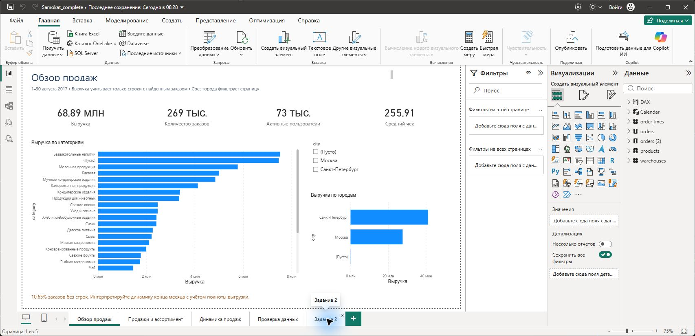
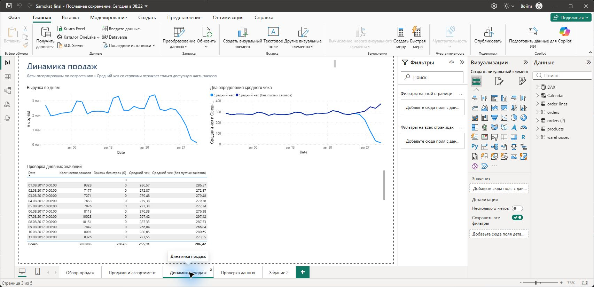
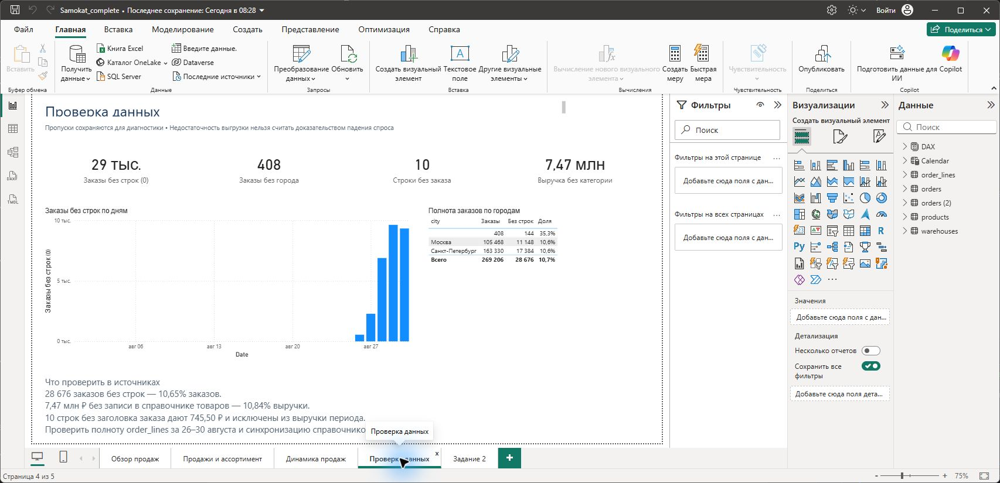

# Конспект выполнения тестового Самокат 2

Задание выполнено по четырём исходным выгрузкам за 1–30 августа 2017 года. Подготовлены отчёт Power BI, список user_id в настоящем формате Excel 97–2003 и SQL-запрос. Главный аналитический результат — неполнота товарных строк в конце периода, которая искажает средний чек и динамику выручки.

За основу взят предоставленный файл Самокат_2.pbix. Его расчёты и источники проверены, ошибки исправлены, страницы переоформлены. Исходный файл и выгрузки на диске не перезаписаны. Этот конспект описывает итоговое решение и позволяет повторить работу.

| Показатель | Результат |
| --- | --- |
| Уникальные заказы | 269 206 |
| Уникальные значения user_id | 72 804 |
| Выручка по строкам с найденным заказом | 68 892 653,08 ₽ |
| Средний чек по всем заказам | 255,91 ₽ |
| Средний чек по заказам со строками | 286,42 ₽ |
| Заказы без строк | 28 676 или 10,65% |
| Пользователи в задании 2 | 4 169 |


## Состав результата

powerbi/Samokat_complete.pbix — основной отчёт с сохранёнными данными. output/task2_users.xls — итоговый список. sql/task3_top_products.sql — запрос топ-5. В docs находятся этот конспект, его Markdown-версия и реальные скриншоты Power BI. Исходные M-запросы и DAX-меры раскрывают преобразования и определения показателей.

Дата подготовки — 17 октября 2026 года. Денежные значения трактуются как рубли; price считается ценой единицы, quantity — количеством. Полей статуса, скидок, возвратов, себестоимости и доставки нет, поэтому прибыль, маржа и SLA не рассчитываются.


# Исходные таблицы и проверка качества

| Таблица | Исходных строк | В модели | Гранулярность |
| --- | --- | --- | --- |
| orders | 269 271 | 269 206 | Один заказ |
| order_lines | 975 171 | 975 171 | Одна товарная строка |
| products | 1 740 | 1 725 | Один SKU |
| warehouses | 74 | 74 | Один склад |


## Контроль ключей

В orders обнаружено 65 полностью совпадающих повторных записей, в products — 15. После удаления точных дублей ключи order_id и product_id уникальны, конфликтующих значений остальных полей у одного ключа нет. В warehouses дубликатов нет. Для проверки использованы сравнение всех полей и отдельная проверка уникальности ключа.

В order_lines также есть 65 полностью совпадающих строк. Они сохранены: уникального line_id нет, а одинаковые позиции могут быть отдельными строками покупки. Сам факт совпадения не доказывает технический дубль. Изменять выручку на этом основании без подтверждения источника нельзя. Это решение явно влияет на суммы и повторяемо.


## Выявленные отклонения

| Отклонение | Факт | Решение |
| --- | --- | --- |
| Цена записана через запятую | Одна строка 16,5 | Локально нормализовать price в Power Query |
| Нечисловой product_id | Одна строка error:) | Сохранить текстовый ключ и сумму |
| Нестандартные user_id | Два заказа | Сохранить; не считать доказанными реальными клиентами |
| Строки без orders | 10 строк на 745,50 ₽ | Отдельная диагностика; исключить из выручки периода |
| Не найден склад | 408 заказов | Сохранить в неизвестной географии |

Часть цен содержит больше двух десятичных знаков. Исходная точность сохранена, округляется только отображение итогов. Это исключает накопление ошибки от построчного округления. SHA-256 каждого исходного файла сохранён в output/summary.json и проверен после работы.


# Подготовка данных в Power Query

Вся подготовка модели выполняется внутри Power BI. Python используется отдельно для независимой проверки и не создаёт очищенные источники для модели. Каждый запрос читает исходный файл через File.Contents и Csv.Document; файл order_lines имеет расширение txt, но содержит табличные данные с разделителем табуляции.

| Источник | Разделитель | Кодировка |
| --- | --- | --- |
| orders | Запятая | UTF-8 65001 |
| order_lines | Табуляция | UTF-8 65001 |
| products | Запятая | Mac Cyrillic 10007 |
| warehouses | Запятая | UTF-8 65001 |

После повышения заголовков удаляются невидимые символы и пробелы по краям. ID остаются текстовыми во всех связанных таблицах: это сохраняет нестандартные ключи и исключает несовпадение типов. Даты приводятся к date, price — к number с локалью en-US, quantity — к Int64.Type. Регистр товарных названий в отчёте сохранён; для отбора кормов используется Text.Lower.


## Исправление локали цены

```
PriceLocale = Table.TransformColumns(Clean,
    {{"price", each Text.Replace(_, ",", "."), type text}}),
Typed = Table.TransformColumnTypes(PriceLocale,
    {{"price", type number}, {"quantity", Int64.Type}}, "en-US")
```

Замена выполняется только в числовом поле price. Для текущих файлов нет разделителей тысяч, поэтому исправление однозначно. Глобальная замена запятых в файле повредила бы CSV и названия товаров.


## Порядок повторения

Открыть Power BI → Преобразование данных → выбрать запрос → Расширенный редактор. Для четырёх таблиц проверить путь, разделитель, кодировку, повышение заголовков и типы. У orders и products удалить только подтверждённые точные дубли. У order_lines повторы оставить. Применить изменения и проверить количество строк по контрольной таблице предыдущей страницы.

Для переноса на другой компьютер откройте «Управление параметрами» и замените SourceFolder на папку с четырьмя оригинальными выгрузками. В поставляемом PBIX параметр указывает на рабочую папку; данные доступны для просмотра без обновления. Файлы powerbi/*.pq содержат те же M-преобразования; SourceFolder.pq задаёт пример значения параметра.


# Модель данных и определения показателей

Модель содержит четыре бизнес-таблицы, календарь Calendar, служебную таблицу мер DAX и отдельную таблицу результата orders (2). SQL задания 3 обращается только к тем же четырём бизнес-таблицам с теми же полями и ключами.

| Таблица на стороне 1 | Таблица на стороне многие | Поле связи |
| --- | --- | --- |
| warehouses | orders | warehouse_id |
| orders | order_lines | order_id |
| products | order_lines | product_id |
| Calendar | orders | Date → order_date |

Все связи активны и направляют фильтр от стороны 1 к стороне многие. Двунаправленная фильтрация не включалась. Календарь охватывает минимальную и максимальную даты orders. Ненайденные ключи формируют пустой элемент измерения; он виден в диаграммах, чтобы потери справочника не скрывались.

```
Выручка строк всего =
SUMX(order_lines, order_lines[price] * order_lines[quantity])

Выручка =
CALCULATE([Выручка строк всего],
    FILTER(order_lines, NOT ISBLANK(RELATED(orders[order_id]))))

Количество заказов = DISTINCTCOUNT(orders[order_id])
Средний чек = DIVIDE([Выручка], [Количество заказов])
Средний чек (без пустых заказов) =
DIVIDE([Выручка], [Количество валидных заказов])
```

Количество валидных заказов в существующем имени меры означает только заказы с товарными строками: 240 530. Оно не гарантирует полноту каждого заказа и не подтверждает оплату. Средний чек 286,42 ₽ по этой группе тоже нельзя автоматически считать истинным чеком всего бизнеса.

Число заказов с товаром считается по order_lines[order_id], а не по orders: при односторонней связи фильтр категории не возвращается из товарных строк в заголовки. Для неизвестного города используется RELATED(warehouses[city]); проверка только пустого orders[warehouse_id] пропустила бы непустые ключи, которых нет в справочнике.


# Обзор продаж и ассортимент



На первой странице четыре карточки отвечают на вопросы о выручке, заказах, пользователях и среднем чеке. Горизонтальные диаграммы показывают категории и города. Срез города позволяет сравнить географию; пустое значение сохраняет заказы с неизвестным складом. Нажатие на столбец категории фильтрует связанные показатели в рамках модели.

Лидер среди известных категорий — безалкогольные напитки, около 7,53 млн ₽. При этом 7,47 млн ₽ выручки не сопоставлено с товарами. Поэтому вывод о концентрации ассортимента предварительный: доли известных категорий нельзя считать полной структурой продаж.

На странице ассортимента сопоставлены физический объём по категориям и десять товаров по выручке. Топ строится динамически в DAX; пустой товар исключается до ранжирования. При равных суммах используется дополнительная сортировка названия, чтобы список содержал ровно десять позиций. Возле неизвестной категории сохраняется её вклад в объём.

Данные описывают покупки, но не остатки. Из высоких продаж нельзя доказать дефицит, из низких — необходимость вывода SKU. Для таких решений потребуются доступность товара, остатки, промо и прибыльность.


# Динамика и неполнота конца периода



С 26 августа появляются заказы без строк. По дням их 551, 2 283, 6 887, 9 627 и 9 328. До 25 августа такие заказы в выгрузке не обнаружены. Дата 31 августа в исходных заказах отсутствует и в дневной таблице не добавляется как день с нулевыми продажами.

| Дата августа | Всего заказов | Без строк | Чек по всем ₽ | Чек со строками ₽ |
| --- | --- | --- | --- | --- |
| 26 | 8 656 | 551 | 275,87 | 294,63 |
| 27 | 8 622 | 2 283 | 224,74 | 305,67 |
| 28 | 10 647 | 6 887 | 122,04 | 345,56 |
| 29 | 10 657 | 9 627 | 32,06 | 331,70 |
| 30 | 9 702 | 9 328 | 14,38 | 372,98 |

30 августа 96,15% заказов не имеют строк. Одновременно число заголовков остаётся высоким, а выручка рассчитывается по немногим доступным заказам. Это согласуется с гипотезой неполной загрузки order_lines. Причину нельзя доказать без журналов выгрузки и проверки первичной системы.

Практическое действие — запросить полную повторную выгрузку строк за 26–30 августа и сверить количество заказов и строк с источником. До этого не использовать падение общей выручки и среднего чека как основание для вывода о падении спроса. Неполные заказы могут также искажать рейтинги товаров задания 3.


# Контроль качества и аналитические ограничения



28 676 заказов без строк составляют 10,65% от 269 206 заказов. Выручка без найденного товара — 7 470 537,75 ₽ или 10,84% выручки сопоставленных заказов. Это 2 803 различных product_id, отсутствующих в products, включая один некорректный текстовый ключ.

408 заказов не сопоставлены со складом; это около 0,15% заказов. Отсутствие склада в справочнике не доказывает операционную проблему доставки. На странице проверки показана доля заказов без строк отдельно для каждого города. Доли не складываются в круговую диаграмму: у городов разные знаменатели.

Десять строк без заголовка orders дают 745,50 ₽. Полная сумма всех строк — 68 893 398,58 ₽; выручка отчётного периода — 68 892 653,08 ₽. Разница объяснена полностью. Строки не удаляются из модели, но не попадают в основную выручку.


## Приоритет действий

Сначала восстановить полноту order_lines, затем актуализировать справочник products и соответствие warehouse_id. После исправления обновить модель и сравнить KPI с контрольными значениями. Отдельно уточнить происхождение повторных строк и нестандартных user_id. Без подтверждения не удалять их и не исправлять ключи догадками.

Уникальные user_id — это число разных значений идентификатора, а не гарантированное количество реальных людей. Доступен один месяц истории, поэтому долгосрочное удержание, сезонность и рост относительно прошлого месяца оценить нельзя.


# Задание 2 и трактовка двух кормов

Основная трактовка — пользователь купил не менее двух единиц подходящего корма суммарно за 1–15 августа включительно. Это могут быть две единицы одного SKU в одном заказе или покупки в разных заказах. Время отсутствует, поэтому границы заданы датами 2017-08-01 ≤ order_date < 2017-08-16.

Сначала выбирается категория «Продукция для животных», затем названия, начинающиеся с «Корм » или «Паштет ». Подходит 66 SKU после исключения Kitekat с кроликом в соусе, 85 г, product_id 3107. Паштет Gourmet включён как корм по смыслу названия. Лакомства, наполнители и прочие товары категории не включены. Это явное правило для данной выгрузки, а не универсальный классификатор.

Исключение относится к товару: его quantity не суммируется. Пользователь, который дополнительно купил Kitekat, остаётся в списке, если у него есть две единицы другого подходящего корма. Заказы с неизвестным SKU невозможно надёжно классифицировать, поэтому они не участвуют в отборе.

| Условие | Пользователей |
| --- | --- |
| Не менее 2 единиц корма — основной результат | 4 169 |
| Ровно 2 единицы корма | 2 316 |
| Не менее 2 разных SKU корма | 2 996 |
| Старая логика всей категории, без SKU 3107 | 5 228 |

Неоднозначность ТЗ отражена этими вариантами. В сдаваемом XLS используется только основной результат. До отправки работодателю при возможности стоит подтвердить, означают ли «2 любых корма» число единиц или число разных SKU.


## Последовательность в Power Query

Создать ссылку на orders → отфильтровать даты → подготовить список Foods из products → соединить его с order_lines по product_id → присоединить строки к заказам по order_id → развернуть quantity → сгруппировать по user_id с суммой quantity → оставить сумму ≥ 2 → оставить один столбец user_id.

В модели результат находится в orders (2), на отдельной странице показана карточка 4 169. XLS содержит 4 169 уникальных текстовых user_id и заголовок. Это настоящий двоичный Excel 97–2003, полученный конвертацией проверенной книги через Excel, а не CSV с переименованным расширением. Независимый SQL дал тот же набор ID.


# Задание 3 и SQL запрос

Запрос написан для PostgreSQL. Все ID — text, order_date — date, price — число, quantity — целое. Первым считается первый наблюдаемый заказ пользователя во всей доступной истории. Город и период применяются после ранжирования. При одинаковой дате выбирается меньший числовой order_id; без времени заказа это необходимое допущение.

```
WITH ranked_orders AS (
    SELECT o.*,
           ROW_NUMBER() OVER (
               PARTITION BY o.user_id
               ORDER BY o.order_date, CAST(o.order_id AS BIGINT)
           ) AS order_rank
    FROM orders AS o
), selected_orders AS (
    SELECT o.order_id
    FROM ranked_orders AS o
    JOIN warehouses AS w ON w.warehouse_id = o.warehouse_id
    WHERE o.order_rank = 1
      AND o.order_date >= '2017-08-15'
      AND o.order_date <  '2017-08-31'
      AND w.city = 'Санкт-Петербург'
), frequency AS (
    SELECT l.product_id, COUNT(DISTINCT l.order_id) AS first_order_count
    FROM selected_orders AS o
    JOIN order_lines AS l ON l.order_id = o.order_id
    GROUP BY l.product_id
)
SELECT f.product_id,
       COALESCE(p.product, 'Нет в справочнике') AS product,
       f.first_order_count
FROM frequency AS f
LEFT JOIN products AS p ON p.product_id = f.product_id
ORDER BY f.first_order_count DESC, f.product_id ASC
LIMIT 5;
```

Частота — число различных первых заказов с товаром. Покупка нескольких единиц и повторные строки не повышают частоту одного заказа. LEFT JOIN справочника сохраняет SKU без названия; группировка по product_id не сливает разные неизвестные товары. Исключение Kitekat относится только к заданию 2.


# Проверка SQL и воспроизведение результата

| product_id | Товар | Первых заказов |
| --- | --- | --- |
| 3107 | Корм Kitekat для кошек, с кроликом в соусе, 85 г | 590 |
| 9736 | Свекла вареная очищенная, 500 г | 399 |
| 1687 | Крабовые палочки Бухта Изобилия имитация, замороженные, 200 г | 394 |
| 2870 | Йогурт Чудо питьевой, с вишней и черешней, 2,4%, 270 г | 394 |
| 3950 | Икра трески Санта Бремор Pate, деликатесная, 90 г | 353 |

В отбор попадает 13 329 первых наблюдаемых заказов пользователей в Санкт-Петербурге за 15–30 августа. При равной частоте товары сортируются по текстовому product_id по возрастанию. Поиск первых заказов ограничен имеющейся историей с 1 августа; утверждать, что это первые покупки клиента за всё время, нельзя.


## Что проверено

Исходные файлы прочитаны с правильными кодировками. Проверены размеры таблиц, дубли, уникальность ключей справочников, положительность количества и неотрицательность цены. Суммы, число заказов, пропуски справочников и результат задания 2 извлечены запросом DAX из работающей модели и сопоставлены с расчётом pandas. Пять товаров SQL совпали с отдельным расчётом первых заказов в pandas.

SQL обоих заданий фактически выполнен в SQLite как проверка общих конструкций JOIN, оконной функции, группировок и фильтров. Для LOWER зарегистрирована функция Unicode Python, поскольку встроенная SQLite не переводит кириллицу в нижний регистр. PostgreSQL-сервер не запускался; его план выполнения и производительность не проверялись.


## Как повторить

1. Открыть powerbi/Samokat_complete.pbix. Для просмотра обновление не нужно. Для обновления изменить параметр SourceFolder в Power Query и нажать «Обновить».
2. Проверить KPI и страницу качества по числам этого конспекта.
3. Установить зависимости из requirements.txt и выполнить python src/analyze.py --source "папка исходных выгрузок". Проверки выполняются автоматически, результаты сохраняются в output.
4. Открыть task2_users.xls: один столбец user_id, 4 170 строк с заголовком, без формул и дубликатов.
5. Выполнить SQL задания 3 в БД с подготовленными четырьмя таблицами; сверить output/task3_top5.csv.

Ограничения воспроизведения: исходные выгрузки не включены в GitHub по условию задания, но PBIX содержит модель с импортированными данными. Конспект и SQL доступны для чтения без Power BI. Отправка письма HR в работу не входила и не выполнялась.
